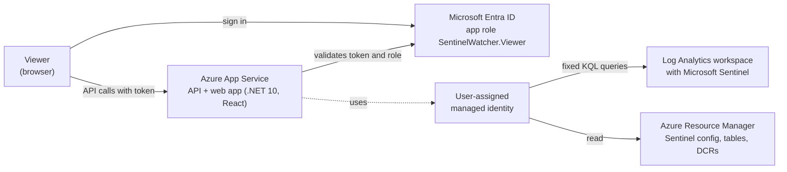

# SentinelWatcher

SentinelWatcher is a web dashboard that shows the health and usage of a Microsoft Sentinel workspace: analytics rules and their incidents, log ingestion and cost, data freshness, data collection rules and Sentinel health events. It is for management, security leads and anyone else who should see these insights without being assigned a security role or activating one through PIM. Viewers only need an Entra app role; the app reads Azure with its own managed identity.

<!-- Screenshot: add docs/images/dashboard.png, then replace the next line with
      -->
*Screenshot coming soon.*

## Features

- **Dashboard:** rules, incidents, ingestion volume and cost, data freshness and DCR status at a glance.
- **Analytics Rules:** incidents of the last 30 days per rule, and where every incident comes from: existing rules, rules that no longer exist, or no analytics rule (for example Microsoft Defender XDR).
- **Log Ingestion:** billable volume and estimated cost per table over 30 days, with estimated volumes and data lake tier tables labeled.
- **Data Connectors (data freshness):** whether each connector's tables receive data, with gap thresholds per connector type and a Quiet state for event-driven connectors.
- **Collection Rules:** data collection rules in the workspace resource group and whether their destination tables receive data. Can be turned off.
- **Sentinel Health (connector health):** health score, failed rule and automation runs, auto-disabled rules, and the latest connector status from `SentinelHealth`.
- **No Azure role for viewers:** access through the Entra app role `SentinelWatcher.Viewer` with "Assignment required".
- **Locked down:** a workspace allow-list, fixed queries only, least-privilege roles for the managed identity, no client secret.

SentinelWatcher only uses **Azure Resource Manager** and the **Log Analytics query API**. It works the same for workspaces managed in the Azure portal and workspaces onboarded to the Microsoft Defender portal.

## Architecture



More in [Architecture](docs/architecture.md).

## Prerequisites

- A Log Analytics workspace with Microsoft Sentinel.
- Entra ID: Application Administrator or Cloud Application Administrator, to create the app registration.
- Azure: Contributor on a resource group for the app, and Owner or User Access Administrator on the resource group of the workspace.
- Azure Cloud Shell (Bash), or the Azure CLI and Bash locally.

## Deploy to Azure

1. Choose an app name. The app will run at `https://<appName>.azurewebsites.net`.
2. Create the app registration in [Azure Cloud Shell](https://shell.azure.com) (Bash) and note the client ID it prints:

   ```bash
   git clone https://github.com/RycnCDL/SentinelWatcher.git && cd SentinelWatcher
   bash scripts/setup-app-registration.sh --redirect-uri https://<appName>.azurewebsites.net --assign-me
   ```

3. Deploy, entering the client ID, the workspace resource ID and the app name:

   [](https://portal.azure.com/#create/Microsoft.Template/uri/https%3A%2F%2Fraw.githubusercontent.com%2FRycnCDL%2FSentinelWatcher%2Fmain%2Finfra%2Fazuredeploy.json)

4. Wait about five minutes for the role assignments, restart the app once, and open it.
5. Assign the **SentinelWatcher Viewer** role to the people or groups who should see it: Entra admin center, Enterprise applications, SentinelWatcher, Users and groups.

## Manual deployment

With the Azure CLI, after step 2 above:

```bash
az group create -n rg-sentinelwatcher -l westeurope
az deployment group create -g rg-sentinelwatcher -n sentinelwatcher \
  --template-file infra/main.bicep \
  --parameters appName=<appName> entraClientId=<client-id> \
               workspaceResourceId=<workspace-resource-id> \
               packageUrl=https://github.com/RycnCDL/SentinelWatcher/releases/download/v0.1.0/sentinelwatcher.zip
az webapp restart -g rg-sentinelwatcher -n <appName>
```

The full guide, including how to check the assigned roles, update, and uninstall, is in [Installation](docs/installation.md).

## Configuration

The template sets everything required. The most important settings:

| Setting | Default | Description |
|---------|---------|-------------|
| `AzureAd:TenantId`, `AzureAd:ClientId` | | App registration used for sign-in |
| `Sentinel:Workspaces` | | Allow-list of workspace resource IDs. Other workspaces get 403. |
| `Sentinel:ManagedIdentityClientId` | | Managed identity for Azure calls. Empty: developer sign-in such as `az login` (local development). |
| `Sentinel:EnableDcrPage` | `true` | Collection Rules page. `false` hides it and needs no DCR access. |
| `ConnectorHealth:WarningAfterMinutes`, `ErrorAfterMinutes` | `60`, `120` | Data freshness thresholds, with overrides per connector type |
| `CacheSettings:HeavyQueryRefreshMinutes` | `10` | Cache refresh interval |
| `CacheSettings:ErrorRetrySeconds` | `30` | Retry interval for sections that failed to load |
| `CacheSettings:CostPerGBDollars` | `2.76` | Price per GB for the cost estimate |

In App Service, use `__` instead of `:` (for example `Sentinel__EnableDcrPage`). All settings and template parameters: [Configuration](docs/configuration.md).

## Permissions

| Who | Needs | Why |
|-----|-------|-----|
| Viewers | App role `SentinelWatcher.Viewer` | Controls who can sign in and call the API. No Azure role: the app reads Azure with its own identity. |
| Managed identity | Microsoft Sentinel Reader on the workspace resource group | Log Analytics queries, Sentinel analytics rules, data connectors and onboarding state, table plans. Resource group scope because the SecurityInsights solution is a sibling of the workspace, not a child. |
| Managed identity | Custom role with only `Microsoft.Insights/dataCollectionRules/read` on the workspace resource group | Collection Rules page. Monitoring Reader is an optional fallback where custom roles are not allowed; nothing is assigned when the page is off. |

Log Analytics Reader is not needed. Microsoft Sentinel Reader can read every workspace in the resource group and allows a few actions beyond reading, so keep the Sentinel workspace in a **dedicated resource group**. Details: [Permissions](docs/permissions.md) and [Security model](docs/security-model.md).

## Troubleshooting

| Symptom | Fix |
|---------|-----|
| AADSTS50105 at sign-in | Assign the SentinelWatcher Viewer role to the user or a group |
| "Need admin approval" | Grant admin consent: App registrations, SentinelWatcher, API permissions |
| Empty pages or "Data is still loading" | Wait for the role assignments, restart the app, check `az webapp log tail` for `AuthorizationFailed` |
| 403 "This workspace is not configured" | Add the workspace to `Sentinel:Workspaces` |
| A DCR shows Error | The log names the destination table without data in the last 24 hours |
| "Could not load data, see server log" | The API could not read Azure. The code says why (for example `AuthenticationFailed`, `AccessDenied`); the server log has the details |

More in [Troubleshooting](docs/troubleshooting.md) and the [FAQ](docs/faq.md).

## Compatibility

| Component | Tested with |
|-----------|-------------|
| .NET | .NET 10 (SDK 10.0.402); App Service runtime `DOTNETCORE\|10.0` on Linux |
| Node.js (build only) | 22 (22.20.0) |
| Microsoft Defender portal | Tested with a workspace onboarded to the Defender portal (October 2026) |
| Azure portal | Uses the same ARM and Log Analytics APIs; a workspace managed only in the Azure portal was not tested separately for 0.1.0 |

SentinelWatcher does not depend on either portal. Microsoft is retiring the Sentinel experience in the Azure portal (end of March 2027), which does not affect SentinelWatcher.

### Known issues

- **DCRs outside the workspace resource group** are not listed on the Collection Rules page.
- **Incident counts in Defender-onboarded workspaces:** incidents created by Microsoft Defender XDR have no analytics rule and are listed as "Defender XDR / no analytics rule". Counts are distinct incidents by creation time over 30 days; queries that count `SecurityIncident` rows count updates and give higher numbers.
- **Fusion rule in Defender-onboarded workspaces:** the Defender portal does not list the Fusion rule (Advanced Multistage Attack Detection), because Defender XDR correlation replaces it. The `alertRules` API still returns it, so SentinelWatcher counts it and shows one rule more than the Defender portal. The app does not mark it, since onboarding to the Defender portal can't be detected through a documented API. See the [FAQ](docs/faq.md#why-does-sentinelwatcher-show-one-more-rule-than-the-defender-portal).
- **Custom detection rules** created in the Defender portal (Advanced Hunting) are not returned by the Sentinel `alertRules` API and are not listed. The Microsoft Graph API for them is in beta (October 2026).
- **Data lake tier tables** can't be read through the Log Analytics query API and show as "Not available in data lake tier". They are detected by the `Auxiliary` table plan; this was confirmed through the tables API, not yet against the Defender portal tier view. Their cost estimate uses the analytics price.
- **Connector health staleness:** Sentinel logs connector health events mainly on status changes and while failing, so a connector that has been healthy for a long time can show as stale on the Sentinel Health page.
- The template configures **one workspace**; more can be added in the app settings.
- Freshness of tables outside the built-in list (for example custom tables) comes from the hourly `Usage` table and is approximate.

## Roadmap

Planned for v0.2:

- Custom detection rules through the Microsoft Graph security API (`/security/rules/detectionRules`, beta as of October 2026).
- Better handling of data lake tier tables.
- An optional custom role with only the actions SentinelWatcher needs, replacing Microsoft Sentinel Reader.
- Data collection rules outside the workspace resource group.
- Several workspaces in the template.

## Contributing and security

See [CONTRIBUTING.md](CONTRIBUTING.md). Report vulnerabilities privately as described in [SECURITY.md](SECURITY.md). Changes are listed in [CHANGELOG.md](CHANGELOG.md).

## License

[MIT](LICENSE), copyright Phillipe Chaves de Lima.
