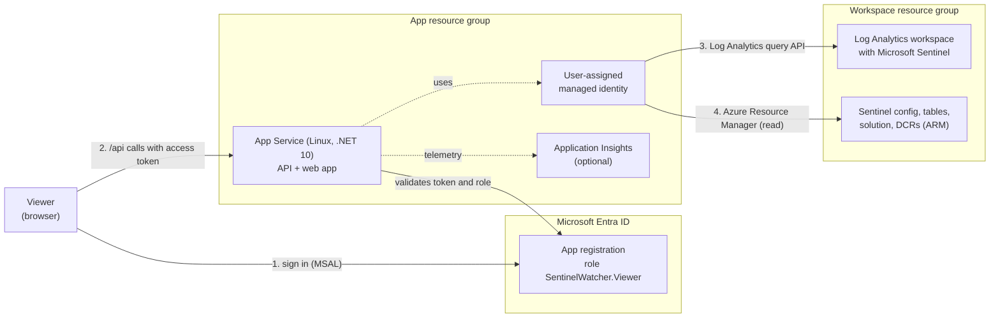

# Architecture

SentinelWatcher is one ASP.NET Core application that serves both the API and the single-page web app from the same origin. It reads Microsoft Sentinel data with a managed identity and keeps the results in memory.

## Components

| Component | Technology | Purpose |
|-----------|------------|---------|
| Web app | React 19, Vite, TypeScript, MSAL | Sign-in, pages and charts. Loads its sign-in settings from `/config.json` at runtime, so one build works for every tenant. |
| API | ASP.NET Core on .NET 10, Microsoft.Identity.Web | Validates tokens, enforces the Viewer role and the workspace allow-list, queries Azure, caches results. |
| Managed identity | User-assigned | The only identity that calls Azure. |
| Hosting | Azure App Service on Linux | Runs the release package (`WEBSITE_RUN_FROM_PACKAGE`). |
| Telemetry | Azure Monitor OpenTelemetry, Application Insights | Optional. Turned on when `APPLICATIONINSIGHTS_CONNECTION_STRING` is set. |

SentinelWatcher only uses **Azure Resource Manager** and the **Log Analytics query API**. It does not depend on the Azure portal or the Microsoft Defender portal, and works the same for workspaces managed in either portal.

## Request flow

1. The browser loads the web app and `/config.json`, then signs in with Entra ID (redirect).
2. Each API call carries an access token for `api://<client-id>/access_as_user`. The API checks the signature, audience and the `SentinelWatcher.Viewer` role.
3. The API matches the `workspace` parameter against `Sentinel:Workspaces`. Unknown workspaces get 403.
4. The API answers from its cache, or starts a refresh that reads Azure with the managed identity.

## Where each page gets its data

| Page | Data | Source |
|------|------|--------|
| Dashboard | Summary of the pages below | Cache |
| Analytics Rules | Rules (name, severity, enabled); incidents created in the last 30 days, the latest row per incident, grouped by rule, or by provider for incidents without a rule | ARM `alertRules`; `SecurityIncident` |
| Log Ingestion | Billable volume per table over 30 days; record counts for important tables that have no Usage data (estimated at 1 KB per record); table tier | `Usage`; `union` over a fixed table list; ARM `tables` |
| Data Connectors (data freshness) | Newest record per table in the last 24 hours, grouped into connectors by table; extra connectors listed by ARM | `union` over a fixed table list and `Usage` (hourly) for other tables; ARM `dataConnectors`; ARM `tables` |
| Collection Rules | DCRs in the workspace resource group, their data flows and destination tables, and whether those tables received data in the last 24 hours | ARM `dataCollectionRules`; the same freshness data as above |
| Sentinel Health (connector health) | Health score, rule and automation runs (24 hours), failure trend, latest status per connector, recent failures, auto-disabled rules | `_SentinelHealth()` |

"Data freshness" and "Connector health" answer different questions: freshness looks at whether data arrives in the tables; connector health is what Microsoft Sentinel itself reports in `SentinelHealth`.

### Status rules

- **Data freshness:** Healthy up to the warning threshold, then Warning, then Error. Defaults are 60 and 120 minutes, with longer defaults for Entra ID and Office 365. Event-driven connectors such as Azure Activity become **Quiet** instead of Warning or Error. Configurable per connector type, see [Configuration](configuration.md#connector-health).
- **Collection Rules:** a DCR is Healthy when every destination table in the selected workspace received data in the last 24 hours, Warning when some did, Error when none did. Destinations in other workspaces and in the data lake tier are shown but not checked.
- **Data lake tier:** tables with the `Auxiliary` plan are in the data lake tier. The Log Analytics query API can't read them, so they show as "Not available in data lake tier" instead of "No data".
- **Connector health:** the latest event per connector (by name and kind). A connector without a health event in the selected range is **stale**.

## Caching

- One cache entry per workspace, shared by all viewers, held in memory only.
- A refresh reads everything for a workspace in two phases: first rules, ingestion, freshness, tiers, connectors and DCRs; then incidents. Pages show the first phase while the incidents load.
- Only one refresh per workspace runs at a time; parallel requests join it.
- Data older than 10 minutes is served while a refresh runs in the background (`CacheSettings:HeavyQueryRefreshMinutes`).
- On the very first request for a workspace, the API waits up to 90 seconds for data.
- Sentinel Health is cached per trend window for the same time.
- Each section (rules and incidents, ingestion, data freshness, DCRs, Sentinel Health) succeeds or fails on its own. A failed section is never stored as empty data: the API returns its error (HTTP 502 with a code and a generic message), or the older data marked as from a failed refresh. Failed sections are retried after 30 seconds (`CacheSettings:ErrorRetrySeconds`).
- Workspaces nobody requested for 30 minutes are removed from memory (`CacheSettings:EvictAfterMinutes`).
- The refresh button on the Analytics Rules page forces a refresh.

## Repository layout

| Path | Content |
|------|---------|
| `src/api` | ASP.NET Core API |
| `src/client` | React web app |
| `tests/SentinelWatcher.Api.Tests` | xUnit tests with fake Log Analytics and ARM |
| `infra` | Bicep template, compiled `azuredeploy.json` |
| `scripts` | App registration setup, package build |
| `.github/workflows` | CI and release |
